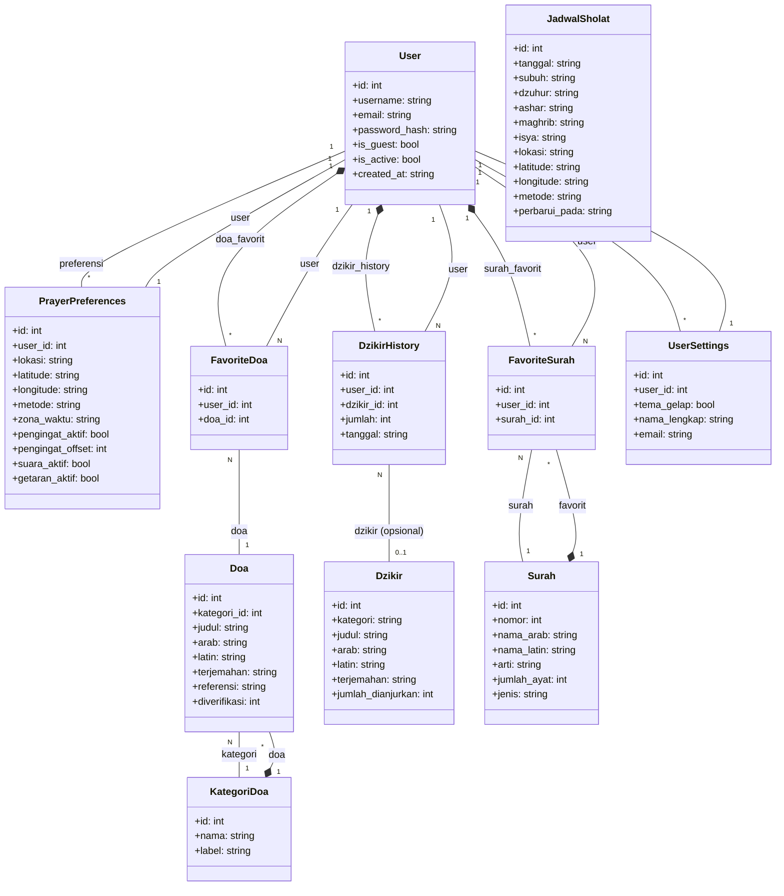
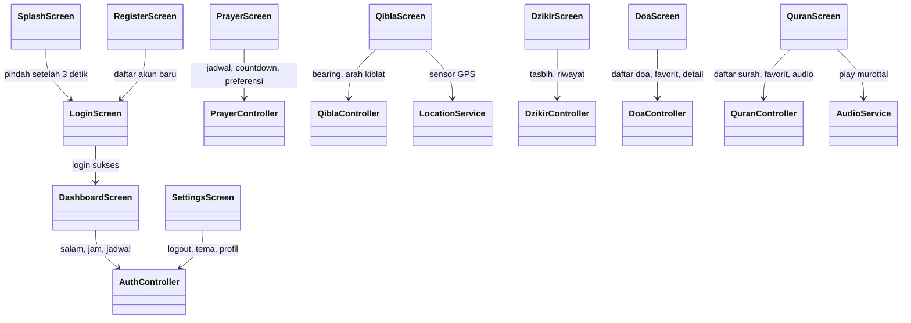

# SALATIFY — Smart Islamic Companion

Aplikasi pendamping ibadah umat Islam untuk Android, berbasis Python, Kivy, dan KivyMD.

**Tagline:** Smart Islamic Companion  
**Slogan:** Your Daily Worship Companion  
**Package:** com.hlrw.salatify  
**Versi:** 1.0.0  
**Pengembang:** Hasan, Luqman, Riza, Wisnu  
**Bahasa:** Indonesia  
**Orientasi:** Portrait

## Fitur Utama

1. **Splash Screen** — Logo, nama aplikasi, tagline, animasi, loading ke halaman autentikasi.
2. **Login & Register** — Username, email, password, konfirmasi password, validasi input, hashing password (PBKDF2-SHA256), sesi pengguna, opsi tetap masuk, mode tamu, logout.
3. **Dashboard** — Salam pembuka, tanggal Masehi & Hijriah, jam digital, lokasi, jadwal sholat lima waktu, countdown ke sholat berikutnya, tombol akses cepat, ringkasan aktivitas dzikir.
4. **Jadwal Sholat** — Subuh, Dzuhur, Ashar, Maghrib, Isya; lokasi via latitude/longitude; data dari API Aladhan; metode perhitungan (prioritas Kementerian Agama RI); penyimpanan offline; countdown.
5. **Pengingat Sholat** — Notifikasi lokal setiap waktu sholat, pengingat 5/10/15 menit sebelumnya, aktif/nonaktif per waktu, suara dan getaran.
6. **Arah Kiblat** — Kompas digital, penunjuk utara, penunjuk arah kiblat, derajat arah kiblat, koordinat pengguna, kalibrasi kompas, status sensor. Perhitungan bearing berdasarkan koordinat Ka'bah.
7. **Wirid & Dzikir** — Dzikir setelah sholat, pagi, petang, tasbih, istighfar, sholawat; teks Arab, latin, terjemahan; tasbih digital dengan tombol tambah/reset, target, progres, getaran, riwayat per pengguna.
8. **Kumpulan Doa** — 14 kategori doa, judul, teks Arab, latin, terjemahan Indonesia, referensi; pencarian, filter kategori, detail, favorit, salin teks.
9. **Al-Qur'an & Murottal** — Daftar 114 surah (seeder 10 surah contoh), nomor, nama Arab/latin, arti, jumlah ayat, jenis; pemutar audio play/pause/stop/volume/progres; pencarian dan favorit surah.
10. **Pengaturan** — Profil, ubah nama/email/password, lokasi, metode perhitungan, notifikasi, suara, getaran, tema terang/gelap, informasi aplikasi, tentang pengembang.

## Teknologi

| Teknologi | Fungsi |
|---|---|
| Python 3 | Bahasa utama |
| Kivy 2.3.2 | Framework Android |
| KivyMD 2.0.0 | Komponen UI |
| SQLite + SQLAlchemy 2.1.9 | Database lokal & ORM |
| Buildozer | Build APK |
| Plyer 2.1.0 | Akses fitur perangkat (GPS, notifikasi) |
| Requests 2.34.2 | Komunikasi API |
| passlib 1.7.4 | Hashing password |
| pytz 2024.2 | Zona waktu |

## Arsitektur MVC

Kode dipisahkan menjadi Model, View, Controller, Service, dan Utils:

- `models/` — Tabel database (User, Doa, Dzikir, JadwalSholat, Surah, dll.)
- `views/` — Layar UI (Splash, Login, Register, Dashboard, Prayer, Qibla, Dzikir, Doa, Quran, Settings)
- `controllers/` — Logika antara model dan view (Auth, Dashboard, Prayer, Qibla, Dzikir, Doa, Quran)
- `services/` — Layanan eksternal (Prayer API, Qibla bearing, Lokasi GPS, Notifikasi, Quran API, Audio)
- `database/` — Inisialisasi DB dan seeder
- `utils/` — Konstanta, keamanan, validator, helper

## Struktur Folder

```
salatify/
├── main.py
├── main.kv
├── requirements.txt
├── buildozer.spec
├── README.md
├── .gitignore
├── models/
├── views/
├── controllers/
├── services/
├── database/
├── utils/
├── assets/images
├── assets/icons
├── assets/fonts
├── assets/audio
├── docs/
└── tests/
```

## Database (SQLite + SQLAlchemy)

Tabel: `users`, `kategori_doa`, `doa`, `favorite_doa`, `dzikir`, `dzikir_history`, `jadwal_sholat`, `prayer_preferences`, `user_settings`, `surah`, `favorite_surah`.

Database otomatis dibuat pada `app_user_data_dir` (Android) atau direktori pengguna (desktop). Password tidak disimpan sebagai teks biasa. Seeder idempoten (tidak duplikasi saat dijalankan berulang).

## API yang Digunakan

- [Aladhan Prayer Times API](https://api.aladhan.com/v1/timings) — jadwal sholat.
- [equran.id API](https://equran.id/api/v2/surah) — daftar surah Al-Qur'an.

Jika API tidak tersedia, aplikasi menampilkan data tersimpan secara offline dan pesan bahwa data belum dapat diperbarui.

## Instalasi Dependensi (Desktop)

```bash
python -m pip install -r requirements.txt
```

## Menjalankan Aplikasi (Desktop)

```bash
python main.py
```

## Menjalankan Pengujian

```bash
python -m unittest discover -s tests
```

## Setup WSL2 Ubuntu (untuk Build APK)

Buildozer tidak berjalan natively di Windows. Gunakan WSL2 Ubuntu:

1. Instal WSL2: `wsl --install` ( restart jika diperlukan )
2. Pastikan distro Ubuntu aktif: `wsl --list --verbose`
3. Masuk Ubuntu: `wsl -d Ubuntu`
4. Instal dependensi build:
   ```bash
   sudo apt update
   sudo apt install -y python3-pip openjdk-17-jdk wget git unzip zip build-essential libssl-dev libffi-dev
   python3 -m pip install --upgrade pip buildozer cython
   ```
5. Salin folder proyek ke Ubuntu atau mount drive Windows.
6. Jalankan build:
   ```bash
   buildozer android debug
   ```

## Build APK

```bash
buildozer android debug
```

File APK hasil build disimpan di `bin/salatify-1.0.0-debug.apk`.

> Catatan: Pada environment pengembangan ini (Windows + Python 3.14), WSL2 Ubuntu belum tersedia (hanya distro docker-desktop yang terhenti). APK belum dibangun pada mesin ini. Untuk hasil APK final, ikuti langkah setup WSL2 Ubuntu di atas dan jalankan `buildozer android debug`.

## Install APK pada Android

1. Aktifkan "Instal dari sumber tidak dikenal" pada pengaturan Android.
2. Salin `salatify-1.0.0-debug.apk` ke smartphone.
3. Buka file APK dan pilih Instal.
4. Berikan izin lokasi dan notifikasi saat diminta.

## Pengujian yang Dilakukan

- Unit test: 22 tes (auth, database, qibla, dzikir, doa, prayer) — semua lulus.
- Smoke test desktop: semua 11 layar termuat, registrasi/login, seeder database.
- Fitur yang memerlukan perangkat Android fisik (GPS, kompas, notifikasi lokal, murottal audio, pengingat background) belum diuji pada mesin ini dan memerlukan pengujian pada smartphone/emulator Android.

## Catatan Keamanan

- Password di-hash dengan PBKDF2-SHA256, tidak disimpan sebagai teks biasa.
- Password tidak ditampilkan di database atau log.
- Data pengguna terpisah per user_id.

## Versi Website

SALATIFY sekarang juga memiliki versi website yang dapat diakses melalui browser Google Chrome dan Microsoft Edge. Versi website menggunakan:

- **Frontend**: HTML, CSS, JavaScript (responsive design, PWA)
- **Backend**: FastAPI (Python) dengan JWT authentication
- **Database**: PostgreSQL (produksi) / SQLite (development)
- **Fitur**: Semua 15 fitur terintegrasi, termasuk landing page, dashboard, jadwal sholat, kiblat, dzikir, doa, Al-Qur'an, dan pengaturan

### Cara Menjalankan Website

Lihat dokumentasi lengkap di `docs/running_local.md`:
- Backend FastAPI: `cd backend && uvicorn main:app --port 8000`
- Website: Buka `http://127.0.0.1:8000/web/index.html` atau file HTML langsung
- API Docs: `http://127.0.0.1:8000/docs`

### Integrasi dengan Aplikasi Android

Adapter API tersedia di `services/api_client.py`. Aplikasi Android tetap berjalan lokal dengan SQLite, adapter opsional untuk sinkronisasi ke backend.

### Deployment

Lihat `docs/running_local.md` untuk panduan deployment ke Render, Heroku, atau VPS.

## Lisensi

Dikembangkan oleh Hasan, Luqman, Riza, dan Wisnu.

## Class Diagram

Diagram kelas lengkap dalam format Mermaid terlihat di bawah ini. Diagram ditampilkan langsung di halaman repository GitHub karena menggunakan sintaks yang didukung GitHub.

### Diagram Model (Database)



### Diagram Controller & Service

```mermaid
classDiagram
class AuthController {
    +register(username, email, password): bool
    +login(username_or_email, password): bool
    +login_guest(): bool
    +logout(): bool
    +change_password(old_password, new_password): bool
}
class DashboardController {
    +salam(nama): str
    +tanggal_masehi(): str
    +tanggal_hijriah(): str
    +jam_digital(): str
    +jadwal_hari_ini(lat, lon, metode): dict
    +countdown_berikutnya(jadwal): tuple
    +ringkasan_dzikir(): int
}
class PrayerController {
    +get_preferences(): PrayerPreferences
    +save_preferences(lokasi, lat, lon, metode, zona_waktu, pengingat_aktif, offset, suara, getaran): PrayerPreferences
    +ambil_jadwal(lat, lon, metode, tanggal): dict
    +jadwal_offline(tanggal): dict
    +hitung_countdown(waktu_str): str
}
class QiblaController {
    +hitung_bearing(lat_user, lon_user): float
    +arah_teks(derajat): str
}
class DzikirController {
    +daftar_dzikir(kategori=None): list
    +simpan_tasbih(jumlah, dzikir_id): bool
    +riwayat(limit=20): list
}
class DoaController {
    +daftar_kategori(): list
    +daftar_doa(kategori=None, q=None): list
    +detail(doa_id): Doa
    +is_favorit(doa_id): bool
    +toggle_favorit(doa_id): bool
}
class QuranController {
    +daftar_surah(q=None): list
    +detail(surah_id): Surah
    +toggle_favorit(surah_id): bool
}
class PrayerService {
    +get_timings(latitude, longitude, metode, tanggal): dict
}
class QiblaService {
    +bearing_kiblat(lat_user, lon_user): float
}
class LocationService {
    +start(): bool
    +stop(): None
}
class NotificationService {
    +kirim(judul, pesan, timeout): bool
    +pengingat_sholat(nama_sholat, waktu): bool
}
class QuranService {
    +daftar_surah(): list
}
class AudioService {
    +play(url): bool
    +stop(): None
    +playing: bool
}

AuthController ..> PrayerService : gunakan
DashboardController ..> PrayerService : gunakan
DashboardController ..> DzikirHistory : query
PrayerController ..> PrayerService : gunakan
PrayerController ..> PrayerPreferences : query/save
PrayerController ..> JadwalSholat : query/save
QiblaController ..> QiblaService : gunakan
QiblaController ..> LocationService : ambil lokasi
DzikirController ..> Dzikir : query
DzikirController ..> User : query history
DzikirController ..> DzikirHistory : simpan/query
DoaController ..> KategoriDoa : query
DoaController ..> Doa : query
DoaController ..> FavoriteDoa : toggle favorit
DoaController ..> User : cek user_id
QuranController ..> QuranService : ambil data
QuranController ..> FavoriteSurah : toggle favorit
QuranController ..> Surah : query
QuranController ..> AudioService : play murottal
AuthController ..> SalatifyApiClient : (opsional) sync ke backend
```



### Diagram View (Screen)



### Diagram Backend FastAPI

```mermaid
classDiagram
class RouterAuth {
    +post("/auth/register"): UserOut
    +post("/auth/login"): Token
    +post("/auth/guest"): Token
    +get("/auth/me"): UserOut
    +post("/auth/logout"): message
}
class RouterUsers {
    +get("/users/me"): UserOut
    +put("/users/password"): message
    +get("/users/settings"): UserSettingsOut
    +put("/users/settings"): UserSettingsOut
}
class RouterDoa {
    +get("/doa/kategori"): list[KategoriDoaOut]
    +get("/doa"): list[DoaOut]
    +get("/doa/{doa_id}"): DoaOut
    +post("/doa/{doa_id}/favorit"): dict
}
class RouterDzikir {
    +get("/dzikir"): list[DzikirOut]
    +get("/dzikir/riwayat"): list[DzikirHistoryOut]
    +post("/dzikir/riwayat"): DzikirHistoryOut
}
class RouterPrayer {
    +get("/prayer/jadwal"): PrayerTimeOut
    +get("/prayer/jadwal/{tanggal}"): PrayerTimeOut
    +get("/prayer/preferensi"): PrayerPreferencesOut
    +put("/prayer/preferensi"): PrayerPreferencesOut
}
class RouterQibla {
    +post("/qibla/hitung"): QiblaResponse
}
class RouterQuran {
    +get("/quran/surah"): list[SurahOut]
    +get("/quran/surah/{surah_id}"): SurahOut
    +post("/quran/surah/{surah_id}/favorit"): dict
    +get("/quran/api/surah"): dict
}
class RouterReminder {
    +get("/reminder"): PrayerPreferencesOut
    +put("/reminder"): PrayerPreferencesOut
}

class UserRegister
class UserLogin
class Token
class UserOut
class KategoriDoaOut
class DoaOut
class DzikirOut
class DzikirHistoryIn
class DzikirHistoryOut
class PrayerTimeOut
class PrayerPreferencesIn
class PrayerPreferencesOut
class PasswordChange
class UserSettingsIn
class UserSettingsOut
class SurahOut
class QiblaRequest
class QiblaResponse

RouterAuth -- UserRegister : request
RouterAuth -- UserLogin : request
RouterAuth -- Token : response
RouterAuth -- UserOut : response
RouterUsers -- UserOut : response
RouterUsers -- UserSettingsIn : request
RouterUsers -- UserSettingsOut : response
RouterDoa -- KategoriDoaOut : response
RouterDoa -- DoaOut : response
RouterDoa -- PasswordChange : request
RouterDzikir -- DzikirOut : response
RouterDzikir -- DzikirHistoryIn : request
RouterDzikir -- DzikirHistoryOut : response
RouterPrayer -- PrayerTimeOut : response
RouterPrayer -- PrayerPreferencesIn : request
RouterPrayer -- PrayerPreferencesOut : response
RouterQibla -- QiblaRequest : request
RouterQibla -- QiblaResponse : response
RouterQuran -- SurahOut : response
RouterQuran -- QiblaRequest : request (api/surah)
RouterReminder -- PrayerPreferencesOut : response

class SalatifyApiClient {
    +base_url: str
    +timeout: int
    +token: str
    +register(username, email, password): Dict
    +login(username_or_email, password): Dict
    +login_guest(): Dict
    +me(): Dict
    +logout(): Dict
    +daftar_doa(kategori, q): list
    +detail_doa(doa_id): Dict
    +toggle_favorit_doa(doa_id): Dict
    +daftar_dzikir(kategori): list
    +riwayat_dzikir(): list
    +simpan_tasbih(jumlah, dzikir_id): Dict
    +jadwal_hari_ini(lat, lon, metode, tanggal): Dict
    +preferensi(): Dict
    +set_preferensi(payload): Dict
    +hitung_kiblat(lat, lon): Dict
    +daftar_surah(q): list
    +detail_surah(surah_id): Dict
    +toggle_favorit_surah(surah_id): Dict
    +profil(): Dict
    +settings(): Dict
    +update_settings(payload): Dict
    +_headers(): Dict
    +_get(path, params): Any
    +_post(path, json): Any
    +_put(path, json): Any
}
```