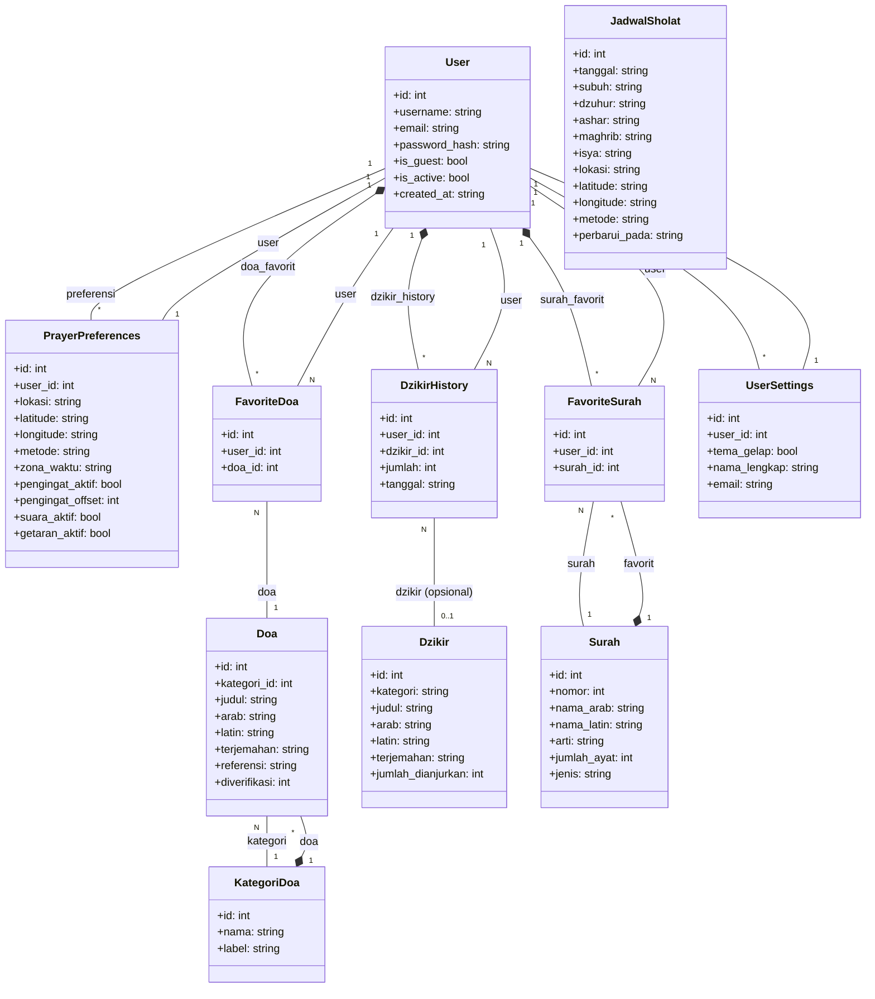

# Class Diagram (Mermaid)

Diagram kelas aplikasi SALATIFY dengan arsitektur MVC, meliputi model database, controller/service, tampilan screen, serta backend FastAPI.

---

## 1. Model (Database)

Diagram ini menampilkan 11 tabel database beserta relasi antar tabel dengan multiplicity (1, 0..*).

